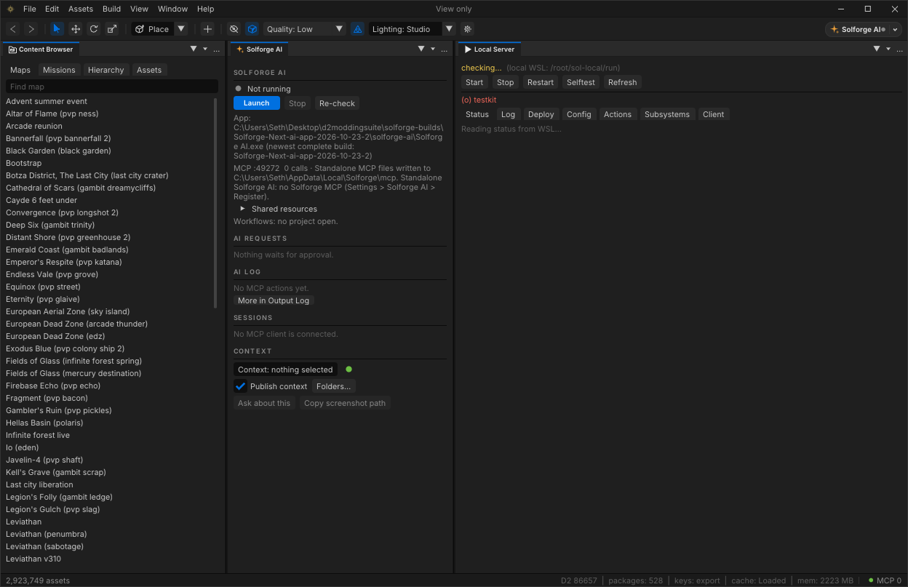

# Solforge Editor UI



Solforge uses a UE5-style editor layout: a two-row chrome bar, tabbed dock areas with drag-and-drop, and animated transitions throughout. The layout is fully user-resizable and saved across sessions.

## Chrome

| Row | Height | Contents |
|---|---|---|
| Menu bar | 30 px | Brand mark · File Edit Assets Build View Window Help · centred project name · window buttons |
| Main toolbar | 40 px | Back/Forward · Select/Move/Rotate/Scale · Place ▾ · Build · Render Quality Lighting · Solforge AI pill |
| Status bar | 24 px | Busy progress / stage · notice text · D2 build · packages · keys · cache · mem · MCP call count |

Narrow windows fold toolbar groups into a **»** overflow menu.

## Default layout — Solforge (UE5)

```
+-------------------+-------------------------------+------------------+
| Place | Assets    |   Viewport / pages            | Outliner         |
| (tab strip)       |   [persp][lit][show][grid]    |                  |
|                   |                               +------------------+
| Place tiles       |   3D viewport / document      | Details          |
|                   |                               |                  |
+-------------------+-------------------------------+------------------+
| Content Browser | Output Log | Changes | Solforge AI       [^ drawer]|
+------------------------------------------------------------------------+
```

- **Place / Assets** (left): Place panel shows creation tiles and category browser. Tab to Assets for the standard content browser.
- **Viewport** (centre): document pages and 3D/2D views.
- **Outliner** (right top): object tree for the open map or mission.
- **Details** (right bottom): inspector for the selected object.
- **Bottom dock**: Content Browser slides open/closed with **Ctrl+Space** as an animated drawer. Output Log, Project Changes and Solforge AI share the same dock row as tabs.

All older layouts remain available under **Window → Layouts**: `Solforge`, `Solforge (AI)`, `Solforge (scene)`, `Solforge (classic)` and `Sunrise Studio`.

## Panels

| Panel | Purpose |
|---|---|
| **Place** | Tile grid over creation types and asset categories. Clicking a tile runs the same create/open action as the creation bar. |
| **Viewport / Workspace** | 3D and 2D asset viewer, Live workbench, document pages (Assets, Materials, Shaders, Audio, Missions…). |
| **Content Browser** | Asset search and navigation. Accessible as a standalone panel or the Ctrl+Space drawer. |
| **Outliner** | Object tree for the current map or mission. |
| **Details / Inspector** | Properties of the selected object, tag or asset. |
| **Output Log** | Status history, busy stages, errors, and the MCP call log. Has a filter box, Copy and Clear view actions. |
| **Project Changes** | Diff view of modified tags. Supports Compare with base, Revert to base, and Export. |
| **Solforge AI** | Status card, pending approval requests, AI edits with Undo, connected sessions and context publishing. |
| **Workflows** | Model workflow team status and controls. |

## Tabbed areas and drag-and-drop

- Each dock area shows a **22 px header strip** with tabs (icon + label + close on hover).
- **Drag a tab** onto another area's header to merge it in, or onto the body's outer 25 % to split the area.
- The **Area menu (…)** offers Move tab to new area and Merge into neighbour.
- Panel tabs in the toolbar dropdown list also control visibility.

## Viewport toolbar

Located inside the Viewport panel, above the 3D view:

- **Perspective / Orthographic** toggle and axis presets (Top/Bottom/Front/Back/Left/Right; Numpad 7/1/3/5).
- **Lit / Unlit / Wireframe** and **Show** dropdown for object type visibility.
- **Grid / Snap** toggle; **Camera** settings.
- **FPS / draw calls / triangle count** overlay (toggled from View > Statistics or the Show dropdown).

Fly camera: **right-drag** to look, **W/A/S/D/Q/E** to move. The scroll wheel sets fly speed while holding right-drag.

## Shortcuts

| Action | Key |
|---|---|
| Toggle Content Browser | Ctrl+Space |
| Solforge AI panel | Ctrl+Shift+A |
| Select tool | Q |
| Move tool | W |
| Rotate tool | E |
| Scale tool | R |
| Axis views | Numpad 7/1/3/5 |

Custom shortcut presets are saved under **Window → Shortcuts**.

## Motion and accessibility

All transitions are driven by `UiMotion` springs: tab underlines, drawer slides, content fades on tab switch, hover fills, toasts, and smooth list scrolling.

**Settings → Interface → Reduce motion** turns off all animations for users who prefer static UI.

## Solforge AI integration

The in-editor AI terminal has been removed. The **Solforge AI pill** in the toolbar and **Ctrl+Shift+A** launch, focus or stop the separate Solforge AI desktop app.

- While Solforge AI is connected, the **Solforge AI panel** shows its status card, approval requests, AI log lines and AI edits with Undo.
- While disconnected, the panel shows a fallback view with pending approval cards.
- **"Ask about this"** and the screenshot button copy a prompt / image path to the clipboard for pasting into any AI client.
- The AI panel and Settings > AI are excluded from MCP UI automation; clients cannot open, close or change them.

To give a standalone Solforge AI session access to the Solforge MCP tools, go to **Settings → Solforge AI → Standalone MCP → Register**. This writes a `solforge-standalone` entry to `~/.claude.json` and adds it to Solforge AI's `importClaudeServers`. Use Unregister to remove it.
